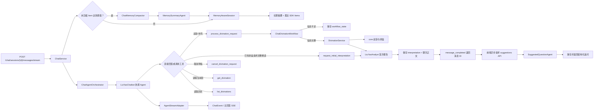

# Agent 代码阅读指南

当前项目使用 OpenAI Agents SDK 的标准 `Agent + Function Tool + Session`。
Chatbot 不使用 Sandbox、Skill、Router Agent 或 Handoff。

当前由四个职责单一的 Agent 协作：

- `LiuYaoChatbot`：协调对话、收集起卦信息、当前卦追问和历史查询。
- `LiuYaoAnalyst`：卦例页面单次解读，以及 Chatbot 新卦或已有排盘的首次正式报告。
- `SuggestedQuestionAgent`：根据最新一轮问答生成结构化 JSON 追问。
- `MemorySummaryAgent`：把旧摘要与已完成的早期 SDK Item 合并为长期记忆。

## 一次聊天请求如何运行



## 推荐阅读顺序

1. `backend/agent/liuyao_agent.py`
   - 原有的 `LiuYaoAnalyst`，继续服务卦例页面的 AI 解读。

2. `backend/agent/chat_orchestrator.py`
   - 固定控制协调 Agent → 首次报告 Agent 的串行顺序。
   - 拦截协调 Agent 对新卦的重复解读，并把正式报告保存到卦例和 SDK Session。

3. `backend/agent/chatbot_agent.py`
   - 多轮 Chatbot 的核心入口。
   - 读取提示词、绑定普通 Function Tools，并调用 `Runner.run_streamed()`。
   - `CHAT_MAX_STEPS` 在这里作为 `max_turns` 生效。

4. `backend/agent/prompt/liuyao_chatbot.txt`
   - 说明普通聊天、新起卦、补充信息、当前卦追问和历史查询的判断顺序。
   - 模型只负责理解自然语言和选择工具，不负责计算卦象。

5. `backend/agent/tools/divination.py`
   - 模型可以调用的五个业务工具。
   - `request_initial_interpretation` 只校验状态并发出编排信号，不在工具内部
     嵌套模型调用；已有报告默认不覆盖。
   - `user_id`、`session_id` 和 Service 从 `RunContextWrapper` 注入，模型不能伪造。

6. `backend/services/chat_divination_workflow.py`
   - 多轮起卦的确定性状态机。
   - 支持逐次追加铜钱结果，并区分“现在”和“指定时间”。
   - 信息不完整时保存 `chat_sessions.workflow_state`，完整后调用
     `DivinationService`。

7. `backend/agent/suggested_question_agent.py`
   - 使用独立 `AgentModelFactory`，可连接便宜的 OpenAI-compatible 模型。
   - 只读取服务端裁剪后的最新问答，输出经 Pydantic 校验的 JSON。
   - 返回空数组或恰好三条追问；失败不影响已经完成的主回答。

8. `backend/utils/suggestion_context.py`
   - 删除固定免责声明，保留用户问题、回答开头和末尾有效段落。
   - `SUGGESTION_CONTEXT_MAX_CHARS` 与
     `SUGGESTION_USER_MESSAGE_MAX_CHARS` 控制输入上限。

9. `backend/agent/memory/`
   - `session.py` 实现 SDK `Session` 的四个方法，并在最近 Item 前注入摘要。
   - `compactor.py` 按 Item 阈值选择旧记录，并把截断点回退到完整用户轮次；
     只删除实际进入摘要输入预算的 `agent_messages`。摘要失败或一整轮超出预算时
     保留全部原始记录。

10. `backend/agent/memory_summary_agent.py`
    - 使用独立 `AgentModelFactory` 生成 `ConversationMemory` JSON。
    - `MEMORY_LLM_API_KEY`、`MEMORY_LLM_BASE_URL` 和 `MEMORY_LLM_MODEL`
      留空时逐项回退主 LLM。

11. `backend/services/divination.py` 与 `backend/core/`
   - 执行真实起卦、排盘、Markdown 生成和数据库保存。

12. `backend/services/chat.py`
   - 保存产品聊天消息，构造可信 `AgentRunContext`，调用编排器。
   - 主 SSE 落库后返回 `message_id`；独立接口按消息 ID 校验所有权、生成并
     缓存 `suggestions` 消息。

13. `backend/agent/runtime/model.py`
   - 显式创建 OpenAI-compatible 模型；主 Agent 与追问 Agent 可以使用不同
     API Key、Base URL、模型和超时时间。

14. `backend/agent/runtime/session.py`
   - 用 SDK `SQLAlchemySession` 保存模型原生上下文，再按配置包装为
     `MemoryAwareSession`。

15. `backend/agent/runtime/stream.py`
    - 把 SDK 原始事件转换为前端稳定的 `ChatEvent`。

## 模型与确定性代码的边界

- 模型：理解用户表达、提取本轮参数、决定是否调用工具、组织解读。
- Function Tool：受控的 Agent 业务入口。
- Workflow：合并草稿、检查缺失字段、处理铜钱顺序和时间模式。
- Service/Core：起卦、排盘、权限和数据库事务。

模型不能自行换算铜钱爻值，也不能编造卦名、干支、六亲、世应或旺衰。

## 两套消息表

- `agent_sessions` / `agent_messages`：SDK 使用的原生模型上下文；被摘要覆盖的旧
  Item 可安全删除。
- `chat_messages`：前端使用的产品消息，包含顺序、状态、工具卡片、追问建议和卦例关联。
- `chat_sessions.summary`：结构化长期记忆；它是派生缓存，不替代完整产品历史。

## 数据库迁移

迁移 `20260728_0005` 增加 SDK Session 表和 `workflow_state`；
迁移 `20260730_0006` 增加 `suggestions` 消息类型；
迁移 `20260731_0007` 增加来源消息外键和一对一唯一约束；
迁移 `20260731_0008` 增加长期摘要的 SDK Item 边界和更新时间：

```bash
python -m alembic -c backend/alembic.ini upgrade head
```

## 关键测试

- `test_chatbot_agent.py`：标准 Agent、Function Tools 和 Chat Completions 兼容。
- `test_agent_session.py`：SDK Session 持久化和窗口限制。
- `test_chat_memory.py`：长期摘要、原始 Item 安全清理和 Session 注入。
- `test_memory_summary_agent.py`：结构化长期记忆 JSON 校验。
- `test_chat_divination_workflow.py`：多轮参数收集、铜钱追加、当前时间和取消流程。
- `test_chat_service.py`：Agent 事件到产品消息的持久化。
- `test_chat_orchestrator.py`：首次报告切换、保存与 SDK Session 回填。
- `test_initial_interpretation_tool.py`：已有排盘、已有报告和所有权校验。
- `test_suggested_question_agent.py`：追问 JSON 解析和约束。
- `test_routes_chat.py`：HTTP + SSE 边界。
