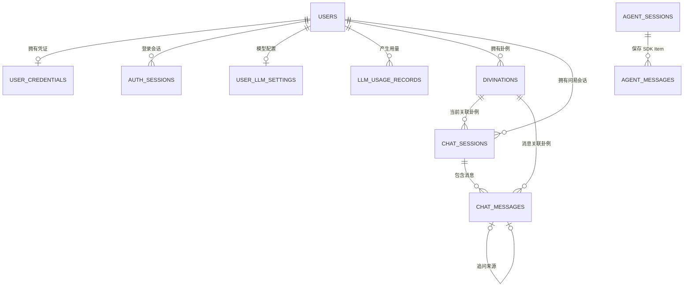

# 数据库设计说明

本文档描述六爻问事项目当前的数据库结构，内容以 `backend/models/` 下的
SQLAlchemy Model 和 `backend/migrations/versions/` 下的 Alembic 迁移为准。

## 1. 当前状态

| 项目 | 当前值 |
|---|---|
| 数据库 | SQLite |
| 异步驱动 | `aiosqlite` |
| ORM | SQLAlchemy 2.x Async ORM |
| 迁移工具 | Alembic |
| 当前迁移版本 | `20260803_0009` |
| 本地默认文件 | `backend/running_data/liuyao.db` |
| Docker 默认文件 | `/data/liuyao.db` |
| 业务表数量 | 10 |

SQLite 每次建立连接时都会执行 `PRAGMA foreign_keys=ON`，因此本文列出的外键删除
规则会真实生效。事务的提交边界位于 Service 层，Repository 只负责数据访问和
`flush`。

## 2. 按模块划分的表

| 模块 | 表 | 主要职责 |
|---|---|---|
| 用户与认证 | `users` | 游客和注册用户的主体记录 |
| 用户与认证 | `user_credentials` | 注册用户的密码哈希 |
| 用户与认证 | `auth_sessions` | HttpOnly Cookie 对应的服务端登录会话 |
| 模型配置与用量 | `user_llm_settings` | 每名用户自己的模型、Base URL 和加密 API Key |
| 模型配置与用量 | `llm_usage_records` | 各 Agent 模型调用的 Token、耗时和状态 |
| 卦例 | `divinations` | 起卦、排盘、Markdown 和 AI 解读结果 |
| Chatbot 业务 | `chat_sessions` | 用户可见的多轮问易会话、工作流状态和长期摘要 |
| Chatbot 业务 | `chat_messages` | 用户可见消息、工具调用、工具结果和推荐追问 |
| Agent SDK 上下文 | `agent_sessions` | OpenAI Agents SDK Session 元数据 |
| Agent SDK 上下文 | `agent_messages` | SDK 保存的模型输入输出 Item |
| 数据库迁移 | `alembic_version` | Alembic 自动维护的当前迁移版本，不属于业务表 |

## 3. 总体关系



`chat_sessions.id` 与 `agent_sessions.session_id` 在业务上使用同一个会话 ID，但目前
没有数据库外键：前者是 UUID 类型，后者是 Agents SDK 要求的字符串类型。删除
Chatbot 会话时，Service 会先显式清理 SDK Session，再删除业务会话。

## 4. 用户与认证模块

### 4.1 `users`

系统身份的根表。游客注册时不会新建另一名用户，而是在原游客记录上升级，因此
此前创建的卦例和会话仍归属于同一个 `user_id`。

| 字段 | 类型 | 可空 | 说明 |
|---|---|---:|---|
| `id` | UUID | 否 | 主键 |
| `user_type` | String(20) | 否 | `guest` 或 `registered` |
| `username` | String(32) | 是 | 用户展示和登录时输入的原始用户名 |
| `username_normalized` | String(32) | 是 | 规范化后的登录名，唯一 |
| `display_name` | String(50) | 是 | 用户昵称 |
| `is_active` | Boolean | 否 | 账号是否可用 |
| `created_at` | DateTime | 否 | 创建时间，UTC |
| `updated_at` | DateTime | 否 | 最近更新时间，UTC |
| `last_login_at` | DateTime | 是 | 最近一次成功登录时间 |

约束和索引：

- `user_type` 检查约束：只允许 `guest`、`registered`；
- `username_normalized` 唯一索引；
- `user_type` 普通索引。

删除用户时，其凭证、登录 Session、模型设置、用量、卦例和 Chatbot 会话都会级联
删除。

### 4.2 `user_credentials`

只为注册用户创建，和 `users` 是一对一关系。密码不会以明文入库，当前使用
Argon2 生成哈希。

| 字段 | 类型 | 可空 | 说明 |
|---|---|---:|---|
| `user_id` | UUID | 否 | 主键，同时是指向 `users.id` 的外键 |
| `password_hash` | String(255) | 否 | Argon2 密码哈希 |
| `password_changed_at` | DateTime | 否 | 最近修改密码时间 |
| `created_at` | DateTime | 否 | 创建时间 |
| `updated_at` | DateTime | 否 | 更新时间 |

删除规则：`users` 删除后级联删除。

### 4.3 `auth_sessions`

浏览器 Cookie 只保存随机 Token，数据库保存它的 SHA-256 哈希。这样数据库泄漏时
也不会直接暴露仍可使用的登录 Token。

| 字段 | 类型 | 可空 | 说明 |
|---|---|---:|---|
| `id` | UUID | 否 | 主键 |
| `user_id` | UUID | 否 | 所属用户，外键到 `users.id` |
| `token_hash` | String(64) | 否 | Session Token 的 SHA-256 哈希，唯一 |
| `expires_at` | DateTime | 否 | 失效时间 |
| `last_seen_at` | DateTime | 否 | 最近使用时间 |
| `revoked_at` | DateTime | 是 | 主动注销或撤销时间 |
| `created_at` | DateTime | 否 | 创建时间 |

索引：`user_id`、`token_hash` 唯一索引、`expires_at`。

删除规则：`users` 删除后级联删除。

## 5. 模型配置与用量模块

### 5.1 `user_llm_settings`

注册用户自带的 OpenAI-compatible 模型连接。每名用户最多一条配置。

| 字段 | 类型 | 可空 | 说明 |
|---|---|---:|---|
| `id` | UUID | 否 | 主键 |
| `user_id` | UUID | 否 | 所属用户，唯一外键到 `users.id` |
| `base_url` | String(500) | 否 | OpenAI-compatible API 地址 |
| `api_key_ciphertext` | Text | 否 | AES-GCM 加密后的 API Key |
| `api_key_last4` | String(4) | 否 | 仅用于前端提示的末四位 |
| `model` | String(100) | 否 | 默认模型 |
| `analyst_model` | String(100) | 是 | 单次正式解读 Agent 模型；空值继承默认模型 |
| `suggestion_enabled` | Boolean | 否 | 是否生成追问建议；关闭后不调用追问 Agent |
| `suggestion_model` | String(100) | 是 | 推荐追问 Agent 模型；空值继承默认模型 |
| `memory_model` | String(100) | 是 | 长期摘要 Agent 模型；空值继承默认模型 |
| `timeout_seconds` | Float | 否 | 模型请求超时时间 |
| `is_active` | Boolean | 否 | 当前配置是否启用 |
| `created_at` | DateTime | 否 | 创建时间 |
| `updated_at` | DateTime | 否 | 更新时间 |

安全说明：

- 数据库只保存密文，不保存 API Key 明文；
- 解密依赖 `USER_LLM_ENCRYPTION_KEY` 或其密钥文件；
- 丢失主密钥后，已有密文无法恢复；
- `user_id` 是唯一索引，保证用户与配置一对一。

删除规则：`users` 删除后级联删除。

### 5.2 `llm_usage_records`

一条记录代表一次 Agent 模型调用。只记录运行元数据，不保存 Prompt、回答正文或
API Key。

| 字段 | 类型 | 可空 | 说明 |
|---|---|---:|---|
| `id` | UUID | 否 | 主键 |
| `user_id` | UUID | 否 | 产生调用的用户 |
| `agent_role` | String(40) | 否 | Agent 角色，如解读、协调、追问、摘要 |
| `model` | String(100) | 否 | 实际调用的模型名 |
| `base_url_host` | String(255) | 否 | 模型服务 Host，不包含 API Key |
| `input_tokens` | Integer | 是 | 输入 Token 数 |
| `output_tokens` | Integer | 是 | 输出 Token 数 |
| `total_tokens` | Integer | 是 | 总 Token 数 |
| `request_count` | Integer | 是 | SDK 本轮产生的模型请求次数 |
| `duration_ms` | Integer | 否 | 总耗时，毫秒 |
| `status` | String(20) | 否 | `completed`、`failed` 或 `cancelled` |
| `error_code` | String(100) | 是 | 失败时的归类错误码 |
| `created_at` | DateTime | 否 | 调用时间 |

约束和索引：

- `status` 枚举检查；
- 输入、输出 Token 不能为负数；
- `user_id`、`agent_role`、`created_at` 分别建立索引。

删除规则：`users` 删除后级联删除。

## 6. 卦例模块

### 6.1 `divinations`

保存一次完整的起卦和排盘结果。排盘、AI 解读使用 JSON 保存，以保持 API 响应结构
并减少大量只用于展示的列。

| 字段 | 类型 | 可空 | 说明 |
|---|---|---:|---|
| `id` | String(32) | 否 | 卦例主键 |
| `user_id` | UUID | 否 | 卦例所有者，外键到 `users.id` |
| `method` | String(20) | 否 | `manual`、`time`、`coin` 或 `random` |
| `question` | Text | 否 | 所问事项 |
| `qigua_time` | DateTime | 否 | 起卦时间 |
| `numbers` | JSON | 是 | 六个爻位编码；纯时间起卦等场景可以为空 |
| `paipan` | JSON | 否 | 完整结构化排盘结果 |
| `interpretation` | JSON | 是 | AI 正式解读结构 |
| `markdown_content` | Text | 是 | 排盘 Markdown 快照 |
| `created_at` | DateTime | 否 | 创建时间 |
| `updated_at` | DateTime | 否 | 更新时间 |

索引：

- `user_id`；
- `(user_id, created_at)`，用于历史卦例按用户和时间倒序读取。

删除规则：

- 删除用户时级联删除卦例；
- 单独删除卦例时，关联的 `chat_sessions.active_divination_id` 和
  `chat_messages.divination_id` 会被设置为 `NULL`，聊天历史本身不会被删除。

## 7. Chatbot 业务模块

### 7.1 `chat_sessions`

一条记录代表用户可见的一段连续问易对话。同一个卦例可以关联多条会话；页面的
“继续问易”默认选择 `last_message_at` 最新的一条，“基于此卦新开讨论”则新增一条。

| 字段 | 类型 | 可空 | 说明 |
|---|---|---:|---|
| `id` | UUID | 否 | 业务会话主键 |
| `user_id` | UUID | 否 | 会话所有者 |
| `title` | String(100) | 是 | 会话标题 |
| `status` | String(20) | 否 | `active` 或 `archived` |
| `active_divination_id` | String(32) | 是 | 当前主要讨论的卦例 |
| `workflow_state` | JSON | 是 | 尚未完成的起卦/排盘领域工作流状态 |
| `summary` | Text | 是 | 长期记忆摘要 |
| `summary_through_agent_message_id` | Integer | 否 | 摘要已覆盖到的 SDK Item ID |
| `summary_updated_at` | DateTime | 是 | 摘要更新时间 |
| `summary_through_sequence` | Integer | 否 | 旧版摘要边界兼容字段，当前不作为 SDK 边界 |
| `next_message_sequence` | Integer | 否 | 下一条业务消息序号，Repository 原子递增 |
| `model` | String(100) | 是 | 会话级模型覆盖配置 |
| `created_at` | DateTime | 否 | 创建时间 |
| `updated_at` | DateTime | 否 | 更新时间 |
| `last_message_at` | DateTime | 否 | 最近一条消息时间，用于会话排序 |

约束和索引：

- `status` 只允许 `active`、`archived`；
- 两个摘要边界字段不能为负数；
- `next_message_sequence` 必须大于 0；
- `user_id`、`active_divination_id` 建立索引；
- `(user_id, last_message_at)` 复合索引用于会话列表。

删除规则：删除用户时级联删除；删除会话时级联删除全部 `chat_messages`。

### 7.2 `chat_messages`

产品层的完整可观察历史。不会保存 ReAct 隐藏思维，只保存用户可见文本、工具调用、
工具结果、摘要投影和结构化推荐追问。

| 字段 | 类型 | 可空 | 说明 |
|---|---|---:|---|
| `id` | UUID | 否 | 消息主键 |
| `session_id` | UUID | 否 | 所属业务会话 |
| `source_message_id` | UUID | 是 | 推荐追问所对应的助手回答，自关联外键 |
| `divination_id` | String(32) | 是 | 本条消息或工具结果关联的卦例 |
| `sequence` | Integer | 否 | 会话内严格递增的消息序号 |
| `role` | String(20) | 否 | `user`、`assistant`、`system`、`tool` |
| `message_type` | String(20) | 否 | `text`、`tool_call`、`tool_result`、`summary`、`suggestions` |
| `content` | Text | 是 | 文本正文 |
| `tool_name` | String(100) | 是 | Function Tool 名称 |
| `tool_call_id` | String(100) | 是 | SDK 工具调用 ID |
| `payload` | JSON | 是 | 工具参数、结果或推荐追问结构化数据 |
| `status` | String(20) | 否 | `pending`、`completed`、`failed`、`cancelled` |
| `token_count` | Integer | 是 | 可选消息 Token 数 |
| `created_at` | DateTime | 否 | 创建时间 |
| `updated_at` | DateTime | 否 | 更新时间 |

约束和索引：

- `(session_id, sequence)` 唯一，保证会话内顺序不重复；
- `source_message_id` 唯一，保证一条助手回答最多缓存一份推荐追问；
- `sequence > 0`，`token_count` 为空或非负；
- `divination_id`、`tool_call_id` 建立索引。

删除规则：

- 删除业务会话时级联删除消息；
- 删除被引用的来源回答时，其推荐追问消息级联删除；
- 删除卦例时只把 `divination_id` 设为 `NULL`。

## 8. Agent SDK 上下文模块

业务消息和 SDK Item 必须区分：

| 数据 | 存储位置 | 面向对象 | 是否适合直接展示 |
|---|---|---|---|
| 产品聊天历史 | `chat_messages` | 用户、前端、审计和业务功能 | 是 |
| 模型上下文 Item | `agent_messages` | OpenAI Agents SDK Session | 否 |
| 长期摘要 | `chat_sessions.summary` | ContextBuilder / MemoryAwareSession | 可查看但不直接作为聊天消息展示 |

### 8.1 `agent_sessions`

表结构与 OpenAI Agents SDK 的 `SQLAlchemySession` 保持一致。

| 字段 | 类型 | 可空 | 说明 |
|---|---|---:|---|
| `session_id` | String | 否 | 主键，值为 `chat_sessions.id` 的字符串形式 |
| `created_at` | DateTime | 否 | SDK Session 创建时间 |
| `updated_at` | DateTime | 否 | SDK Session 更新时间 |

`agent_sessions` 本身不保存 `user_id`，使用前必须先通过 `chat_sessions` 校验会话所有权。

### 8.2 `agent_messages`

| 字段 | 类型 | 可空 | 说明 |
|---|---|---:|---|
| `id` | Integer | 否 | 自增主键，同时作为长期摘要边界 |
| `session_id` | String | 否 | 外键到 `agent_sessions.session_id` |
| `message_data` | Text | 否 | SDK Item 的序列化数据 |
| `created_at` | DateTime | 否 | 创建时间 |

索引：`(session_id, created_at)`。

删除规则：删除 `agent_sessions` 后级联删除对应的 `agent_messages`。

## 9. Alembic 版本表

### 9.1 `alembic_version`

Alembic 自动创建和维护，只包含当前迁移版本号。业务代码不应直接修改这张表。
当前值应为：

```text
20260803_0009
```

应用迁移命令：

```bash
python -m alembic -c backend/alembic.ini upgrade head
```

## 10. 常用数据库查看命令

以下命令均在仓库根目录执行。

查看所有表：

```bash
sqlite3 backend/running_data/liuyao.db ".tables"
```

查看某张表的建表 SQL：

```bash
sqlite3 backend/running_data/liuyao.db ".schema chat_sessions"
```

查看字段：

```bash
sqlite3 backend/running_data/liuyao.db \
  "PRAGMA table_info(chat_sessions);"
```

查看外键：

```bash
sqlite3 backend/running_data/liuyao.db \
  "PRAGMA foreign_key_list(chat_messages);"
```

查看索引：

```bash
sqlite3 backend/running_data/liuyao.db \
  "PRAGMA index_list(chat_messages);"
```

查看当前迁移版本：

```bash
sqlite3 backend/running_data/liuyao.db \
  "SELECT version_num FROM alembic_version;"
```

查看某个用户的数据规模：

```sql
SELECT
    u.id,
    u.username,
    COUNT(DISTINCT d.id) AS divination_count,
    COUNT(DISTINCT cs.id) AS chat_session_count
FROM users AS u
LEFT JOIN divinations AS d ON d.user_id = u.id
LEFT JOIN chat_sessions AS cs ON cs.user_id = u.id
GROUP BY u.id, u.username;
```

## 11. 设计注意事项

1. SQLite 当前只运行一个后端实例，不要横向扩展多个写入副本。
2. 所有用户资源查询必须同时限定资源 ID 和 `user_id`，不能只按资源 ID 查询。
3. `paipan`、`interpretation` 和 `message_data` 属于结构化快照；修改 JSON 结构时要考虑
   历史数据兼容。
4. `chat_messages` 是产品历史，`agent_messages` 是模型上下文，不能互相替代。
5. 长期摘要是 SDK Item 的派生缓存，完整业务记录仍以 `chat_messages` 为准。
6. 备份数据库时必须同时备份用户 LLM API Key 的加密主密钥，否则密文无法恢复。
7. 修改 Model 后应生成 Alembic 迁移，不要只依赖 `Base.metadata.create_all()` 修改生产库。
